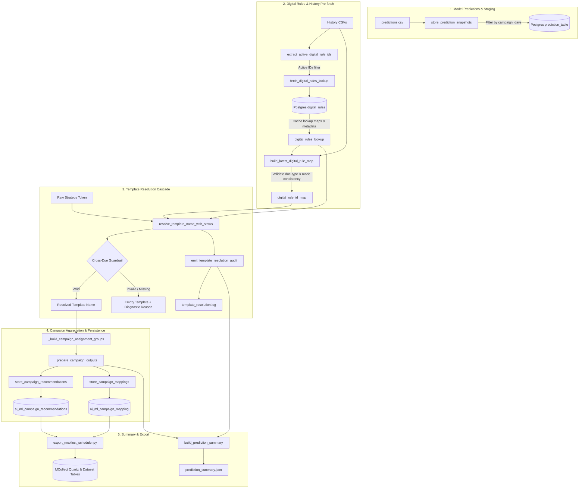

# Template Resolution and Campaign Generation Flow

## 1. Overview and Purpose

In the campaign recommendation lifecycle, machine learning models predict **channel, time-of-day, and language strategy tokens** (e.g., `SMS-11AM-ENGLISH`, `WHATSAPP-2PM-HINDI`) for individual loan accounts across EMI-relative days.

However, execution systems such as **MCollect Digital** do not execute raw ML tokens. They require:
1. **Concrete Template / Iteration Names**: Registered in MCollect's `digital_rules` table (e.g., `PREDUE_AIML_SMS_ENGLISH`, `POSTDUE-SMS`).
2. **Aggregated Schedulers**: Groups of accounts sharing the same due bucket, communication channel, vertical, language, risk tier, EMI cycle, vendor, and dispatch schedule.
3. **Target Customer Datasets**: Dynamic SQL definitions extracting matching account numbers for each campaign run.
4. **Quartz Job & Trigger Definitions**: Pre-scheduled cron triggers executing against MCollect digital jobs (`BatchSMSJob`, `BatchWhatsappJob`, `BatchVoiceJob`).

This document details the complete architectural flow implemented in [scripts/run_monthly_inference_pipeline.py](file:///home/aditya/aiml/campaign-recommendation/scripts/run_monthly_inference_pipeline.py) (lines [3864–3896](file:///home/aditya/aiml/campaign-recommendation/scripts/run_monthly_inference_pipeline.py#L3864-L3896)), explaining how raw predictions are converted into validated, audited campaign recommendations and customer mappings.

---

## 2. End-to-End Architecture Flow



---

## 3. Step-by-Step Logic Breakdown

### Step 1: Storing Prediction Snapshots
- **Function**: [store_prediction_snapshots()](file:///home/aditya/aiml/campaign-recommendation/scripts/run_monthly_inference_pipeline.py#L868)
- **Role**:
  - Ingests the output `predictions.csv`.
  - Filters by the configured prediction month.
  - Dynamically enforces `campaign_days` (derived from `allowed_day_offsets` in [config/default_config.json](file:///home/aditya/aiml/campaign-recommendation/config/default_config.json)). Any day offset outside the active window (e.g. `D+6` to `D+20`) is blanked to `"-"`.
  - Persists JSON snapshot payloads into `digital_collections.ai_ml_prediction_snapshots`.

---

### Step 2: Extracting Active Digital Rule IDs
- **Function**: [extract_active_digital_rule_ids()](file:///home/aditya/aiml/campaign-recommendation/scripts/run_monthly_inference_pipeline.py#L1064)
- **Problem Solved**: MCollect's `digital_rules` table contains thousands of historical and test rules. Scanning or querying all rows adds database overhead and can match stale test iterations.
- **Solution**:
  - Inspects historical communication CSV files within the active training/inference window.
  - Extracts the distinct, active `digital_rule_id` values actually used in production communications.
  - Returns a sorted list of unique active numeric IDs for targeted querying.

---

### Step 3: Fetching and Indexing Digital Rules from Postgres
- **Function**: [fetch_digital_rules_lookup()](file:///home/aditya/aiml/campaign-recommendation/scripts/run_monthly_inference_pipeline.py#L1111)
- **Helper**: [_normalize_campaign_identifier_due_type()](file:///home/aditya/aiml/campaign-recommendation/scripts/run_monthly_inference_pipeline.py#L1089)
- **Database Query**:
  ```sql
  SELECT id, mode_ AS mode, language, campaign_identifier, iteration
  FROM digital_collections.digital_rules
  WHERE iteration IS NOT NULL AND iteration <> ''
    AND id = ANY(%s)
  ORDER BY id ASC;
  ```
- **Indexing Structure**:
  Constructs multiple lookup indices in memory:
  1. **Cohort Index**: `(due_type, mode, language) -> iteration`
  2. **Default Language Fallback**: `(due_type, mode, "DEFAULT") -> iteration`
  3. **Rule ID Index**: `(rule_id_str, mode, language) -> iteration`
  4. **Strict Due-Type Rule Index**: `(rule_id_str, due_type, mode, language) -> iteration`
  5. **Rule Metadata (`RULE_META`)**: Preserves canonical `{due_type, mode, language, iteration}` to cross-validate historical usages against database definitions.

---

### Step 4: Building the Historical Communication Rule Map
- **Function**: [build_latest_digital_rule_map()](file:///home/aditya/aiml/campaign-recommendation/scripts/run_monthly_inference_pipeline.py#L1268)
- **Validation Guardrail**:
  When reading historical communication CSVs, each past touchpoint is checked:
  1. Computes the communication due type from `date` and `emi_date` (`diff < 0` => `PREDUE`, `diff > 0` => `POSTDUE`).
  2. Compares the communication due type and channel against the database definition stored in `RULE_META`.
  3. **Rejection of Inconsistent Rules**: If a communication was sent pre-due, but the recorded `digital_rule_id` belongs to a post-due template, the rule is **rejected** and logged to prevent cross-contamination.
- **Mapping Built**:
  - `(apac, due_type, mode, language) -> (rule_id, template_name)`
  - `("COMM_COHORT", due_type, mode, language) -> latest template used in comms`

---

### Step 5: Multi-Tier Template Resolution Cascade
- **Function**: [resolve_template_name_with_status()](file:///home/aditya/aiml/campaign-recommendation/scripts/run_monthly_inference_pipeline.py#L1395)
- **Priority Cascade**:

| Tier | Priority Step | Condition | Example Output | Status Tag |
| :---: | :--- | :--- | :--- | :--- |
| **1** | **Account Historical Rule Match** | Account has previous communication with matching `(due_type, mode)` verified against `RULE_META`. | `PREDUE_AIML_SMS_ENGLISH` | `ACCOUNT_RULE_MATCH` |
| **2** | **Communication Cohort Match** | Account is new/unmatched, but other accounts in latest communications used a template for `(due_type, mode, language)`. | `PREDUE WHATSAPP ENGLISH` | `COMM_COHORT_MATCH` |
| **3** | **Communication Language Fallback** | Template found for `(due_type, mode, "DEFAULT")` or `(due_type, mode, "ENGLISH")` from live comms. | `POSTDUE-SMS` | `COMM_LANG_FALLBACK` |
| **4** | **Database Digital Rules Cohort** | Cohort matched directly against Postgres `digital_rules` table. | `PREDUE_SMS` | `DB_COHORT_MATCH` / `DB_LANG_FALLBACK` |
| **5** | **Diagnostic Failure** | No template found in database or communication history. Returns empty string `""` with detailed reason. Never falls back to hardcoded config values. | `""` | `FAILED` |

> [!IMPORTANT]
> **No Silent Synthetic or Hardcoded Fallbacks**: In previous versions, unresolved templates generated synthetic strings or fell back to config defaults. The system now returns empty `""` and logs clear diagnostic failure details so teams can add missing templates to MCollect. Hardcoded config template fallbacks have been completely removed to protect production.

---

### Step 6: Pre-due vs. Post-due Safety Guardrail
- **Function**: [validate_template_due_type_consistency()](file:///home/aditya/aiml/campaign-recommendation/scripts/run_monthly_inference_pipeline.py#L1252)
- **Rule**:
  - If campaign `due_type == "PREDUE"` and template name contains `"POST"`, resolution is rejected.
  - If campaign `due_type == "POSTDUE"` and template name contains `"PRE"`, resolution is rejected.
- **Guarantee**: Customers scheduled before their EMI due date **never** receive overdue/defaulter verbiage.

---

### Step 7: Dedicated Standalone Audit Logging
- **Logger**: [get_template_logger()](file:///home/aditya/aiml/campaign-recommendation/scripts/run_monthly_inference_pipeline.py#L1224)
- **Log Destination**: `artifacts/logs/template_resolution.log`
- **Audit Reporter**: [emit_template_resolution_audit()](file:///home/aditya/aiml/campaign-recommendation/scripts/run_monthly_inference_pipeline.py#L1550)
- **Features**:
  - Standalone logger does not pollute the primary inference pipeline log.
  - Produces an executive audit table at the conclusion of campaign preparation:
    - Total communication touchpoints evaluated
    - Breakdown by resolution tier (historical matches, cohort matches, language fallbacks, database cohort matches)
    - Complete count and list of active templates in use
    - Explicit list of failed touchpoints with actionable diagnostic reasons.

---

### Step 8: Campaign Output Preparation & Aggregation
- **Functions**:
  - [_build_campaign_assignment_groups()](file:///home/aditya/aiml/campaign-recommendation/scripts/run_monthly_inference_pipeline.py#L2143)
  - [_prepare_campaign_outputs()](file:///home/aditya/aiml/campaign-recommendation/scripts/run_monthly_inference_pipeline.py#L2300)
- **Aggregation Logic**:
  1. Accounts are grouped by `(base_name, time, date, template_name, vendor, language, emi_cycle, risk, vertical, due_type)`.
  2. Multiple communication dates for the same cohort are joined (e.g. `[D-4,D-2]`).
  3. Schedulers are named deterministically:
     ```text
     {due_type}_AIML_{channel}_{vertical}_{language}_{risk_code}_{emi_cycle}TH_{vendor}_{run_token}
     ```
     Example: `PREDUE_AIML_SMS_LAP_ENGLISH_MR_5TH_PRUTECH_151026`
  4. Generates two coordinated DataFrames:
     - `campaign_df`: High-level scheduler specifications (1 row per scheduler).
     - `mapping_df`: Granular account allocations (1 row per account per scheduler).

---

### Step 9: Database Persistence and Idempotency
- **Functions**:
  - [store_campaign_recommendations()](file:///home/aditya/aiml/campaign-recommendation/scripts/run_monthly_inference_pipeline.py#L2546)
  - [store_campaign_mappings()](file:///home/aditya/aiml/campaign-recommendation/scripts/run_monthly_inference_pipeline.py#L2632)
- **Target Tables**:
  - `digital_collections.ai_ml_campaign_recommendations`
  - `digital_collections.ai_ml_campaign_mapping`
- **Idempotency Guarantee**:
  Before insertion, both functions execute:
  ```sql
  DELETE FROM {table_ref}
  WHERE source_month = %s
    AND prediction_month = %s
    AND model_name = %s;
  ```
  Re-running inference cleanly replaces the target month's staged recommendations without duplicate records.

---

### Step 10: Summary Export & MCollect Quartz Scheduling
- **Prediction Summary**: [build_prediction_summary()](file:///home/aditya/aiml/campaign-recommendation/scripts/run_monthly_inference_pipeline.py#L498) embeds the `template_summary` dictionary into `artifacts/logs/<predict_month>_prediction_summary.json`.
- **MCollect Export**: [scripts/export_mcollect_scheduler.py](file:///home/aditya/aiml/campaign-recommendation/scripts/export_mcollect_scheduler.py):
  1. Upserts dataset definitions into `digital_collections.dataset` (`ON CONFLICT (name) DO UPDATE`).
  2. Upserts Quartz jobs into `digital_collections.qrtz_job_details` with Java-serialized `JobDataMap`.
  3. Replaces active triggers in `digital_collections.qrtz_triggers` and `digital_collections.qrtz_cron_triggers`.

---

## 4. Configuration Reference

Key parameters in [config/default_config.json](file:///home/aditya/aiml/campaign-recommendation/config/default_config.json) governing this flow:

```json
{
  "allowed_day_offsets": [-5, -4, -3, -2, -1, 1, 2, 3, 4, 5],
  "send_hour_window": {
    "start_hour": 9,
    "end_hour": 18,
    "step_hours": 1
  }
}
```

- **`allowed_day_offsets`**: Controls which EMI-relative days are active. Drives dynamic training window calculation (`"10 days"`) and suppresses unconfigured days.
- **`send_hour_window`**: Clamps dispatch times between allowed operational hours (e.g., 9:00 AM to 6:00 PM).

---

## 5. Verification and Auditing Commands

### Run Full Test Suite
```bash
./venv/bin/python -m pytest
```

### Inspect Standalone Template Resolution Audit
```bash
cat artifacts/logs/template_resolution.log
```

### Verify Staged Recommendations in Postgres
```sql
SELECT due_type, mode, template_name, vendor, count(*) 
FROM digital_collections.ai_ml_campaign_recommendations
WHERE prediction_month = 'MAY-2026'
GROUP BY due_type, mode, template_name, vendor
ORDER BY due_type, mode;
```
